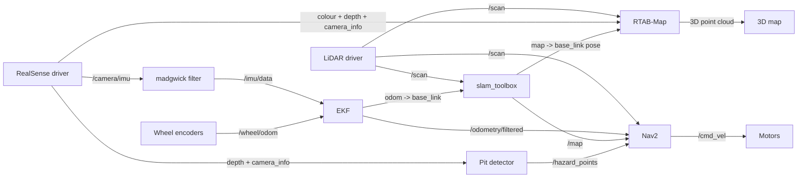

# SLAM Architecture

How the 2D (LiDAR + slam_toolbox) and 3D (RealSense + RTAB-Map) SLAM get wired together in ROS 2, and what we expect to tune.

---

## Graph

---

## Nodes

- **LiDAR driver**
- **RealSense driver**
- **madgwick** (IMU orientation filter)
- **Wheel odometry** (from encoders)
- **EKF** (`robot_localization`)
- **slam_toolbox**
- **RTAB-Map**
- **Pit detector** (ours)
- **Nav2**
- **Motor driver**

---

## Topic map

| Topic | From | To |
|---|---|---|
| `/scan` | LiDAR driver | slam_toolbox, RTAB-Map, Nav2 |
| `/camera/color/image_raw` | RealSense | RTAB-Map |
| `/camera/aligned_depth_to_color/image_raw` | RealSense | RTAB-Map, pit detector |
| `/camera/color/camera_info` | RealSense | RTAB-Map |
| `/camera/aligned_depth_to_color/camera_info` | RealSense | pit detector |
| `/camera/imu` | RealSense | madgwick |
| `/imu/data` | madgwick | EKF |
| `/wheel/odom` | wheel odometry | EKF |
| `/odometry/filtered` | EKF | Nav2 |
| `/map` | slam_toolbox | Nav2 |
| `/rtabmap/cloud_map` | RTAB-Map | RViz / saved output |
| `/hazard_points` | pit detector | Nav2 |
| `/cmd_vel` | Nav2 | motor driver |

---

## Transforms

Each transform gets exactly one publisher. Two publishers for the same one and TF starts flickering.

| Transform | Published by |
|---|---|
| `map -> odom` | slam_toolbox |
| `odom -> base_link` | EKF |
| `base_link -> laser`, `base_link -> camera_link` | URDF |
| everything below `camera_link` | RealSense driver |

> Measure the real mount positions with a tape measure. A few cm of error is enough to smear the map.

---

## Odometry (EKF)

- **Wheels:** forward speed and turn rate. Give them a real covariance instead of zeros, with more uncertainty on turning since the wheels slip.
- **IMU:** roll, pitch and turn rate only. No absolute yaw, because without a compass it just drifts.
- madgwick runs with the **magnetometer off**.
- The IMU's axes are rotated compared to the rover. Rotate them into `base_link` first, then tilt the rover by hand and check the numbers move the right way.
- 30 Hz, with 2D mode off so roll and pitch come through.

---

## slam_toolbox settings

| Setting | Value / note |
|---|---|
| Mode | async |
| Max laser range | what our LiDAR actually manages, not the datasheet number |
| Min travel distance / heading | ~0.15 m / 0.15 rad. Sets how often a scan gets processed, so this is the first thing to raise if the board struggles |
| Loop closure thresholds | too low and the map folds onto itself, too high and it never closes. Tune on a recorded loop |
| Saving | occupancy grid (just a picture) or pose graph (can be reloaded to keep mapping) |

> Mapping from a cold start has to work. We can't rely on a pre-made map of the arena.

---

## RTAB-Map settings

| Setting | Value / note |
|---|---|
| Detection rate | 1 Hz, the biggest CPU saver |
| Time threshold | ~700 ms, so old parts of the map move out of RAM |
| Features / cloud decimation / voxel / max depth | ~600 / 4 / 5 cm / 4 m |
| RealSense profile | 640x480 at 30 fps. Only drop to 15 fps, then 424x240, if CPU is maxed |
| Driver point cloud | off, RTAB-Map builds its own |
| 2D grid | off, slam_toolbox already does that |

---

## 3D map lining up with the 2D map

Run both SLAMs independently and they drift in different ways, so the two maps won't match. The fix is to let **slam_toolbox lead and RTAB-Map follow**:

1. slam_toolbox owns `map -> odom`. RTAB-Map publishes no transforms.
2. RTAB-Map takes the slam_toolbox pose as its odometry, so every 3D keyframe is placed with the same pose as the 2D map.
3. RTAB-Map's own loop closure starts off, otherwise the two keep fighting over the pose.

**The catch:** when slam_toolbox closes a loop its pose jumps, and the older part of the 3D cloud can sit slightly off until it's rebuilt from the corrected poses.

**Plan B:** use RTAB-Map as the only SLAM. It takes the scan too and can make the 2D grid, so the two maps line up by construction. We'd lose slam_toolbox's Nav2 integration though.

> Not tested yet. First thing to check on a recorded loop is whether the cloud actually sits on the 2D map.

---

## Pit detector

The LiDAR won't catch these, so the depth camera does:

1. From the camera calibration and its height and angle on the rover, work out what depth each pixel should read if the ground were flat.
2. Compare that with the real depth image. Much closer means a bump or boulder, much farther means a pit.
3. Put those spots on the ground and hand them to Nav2 as obstacles.

| Setting | Start at |
|---|---|
| Pit margin | ~15 cm |
| Bump margin | ~10 cm |
| Pixel stride / frame skip | every 4th pixel / every 2nd frame |
| Max range | ~3 m |

- It assumes flat ground and a stiff camera mount, so start with big margins and tighten later.
- Pixels with **no depth are not counted as pits**. Shadows and shiny rocks return nothing too, and the rover would stop for no reason.

---

## Nav2

We only launch the navigation part, not the full bringup, since that one also starts AMCL and a map server that slam_toolbox already replaces.

- **Global costmap:** the slam_toolbox map plus the scan.
- **Local costmap:** follows `odom` so it doesn't jump when a loop closes. Takes the scan and the pit points.
- Pit points are marking only, never cleared. Nothing else would clear them anyway.

---

## Performance

We have no real numbers yet, so the first job is measuring. These are the settings we'd start from.

**What to log each run:** camera and depth resolution, fps, RTAB-Map settings, IMU on or off, and which nodes were running. Check topic rates with `ros2 topic hz` and CPU/RAM per node with `top` (`tegrastats` on a Jetson). Run it for at least 10 minutes, because RTAB-Map keeps getting heavier as the map grows.

**If CPU is a problem, cut in this order:**

1. RTAB-Map detection rate
2. RTAB-Map feature count
3. Cloud decimation
4. slam_toolbox travel thresholds
5. Camera fps

**System side:**

- CycloneDDS with traffic kept on localhost (switch that off when viewing from a laptop), plus a bigger network receive buffer. Without it the camera topics drop frames at random and it looks like a driver bug.
- USB 3 and a short, decent cable. Most camera dropouts we've read about are cable or power problems.
- Composable nodes might save some copying between processes. Try it last and check the CPU actually drops.

**Record and replay:** save the raw sensor topics in a bag and tune at the desk instead of driving every time. Three runs are worth recording: a loop back to the start, a pass by a hole, and a drive over bumps.

**A config passes if** the topic rates hold for the whole run, there are no TF warnings, and RAM levels off instead of climbing.

---

## Common problems

| Symptom | Likely cause |
|---|---|
| No `map -> odom` | scan isn't reaching slam_toolbox (QoS mismatch, wrong topic or frame name) |
| Smeared map | LiDAR position in the URDF is wrong, or the clocks don't match |
| 3D cloud off the 2D map | RTAB-Map isn't using the slam_toolbox pose, or its loop closure is fighting it |
| Rover stuck after a bump | pit detector marked something, loosen the margins |

---

## Summary

- 2D SLAM from the LiDAR through slam_toolbox, 3D from the RealSense through RTAB-Map, with slam_toolbox owning the transforms so both maps share the same poses.
- The EKF mixes wheels and IMU, with no compass and no absolute yaw.
- A small depth-based pit detector covers what the LiDAR can't see.
- Performance is still unmeasured, so the next step is recording a few runs and working down the cut list.
